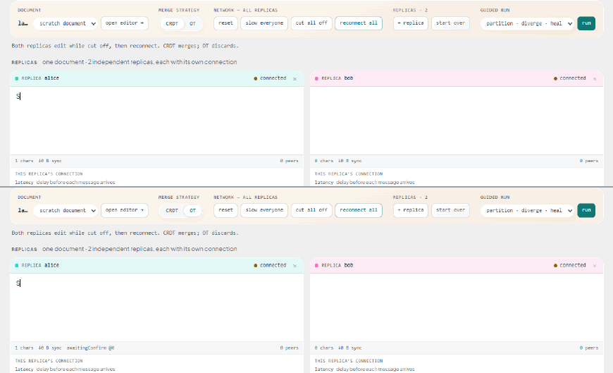
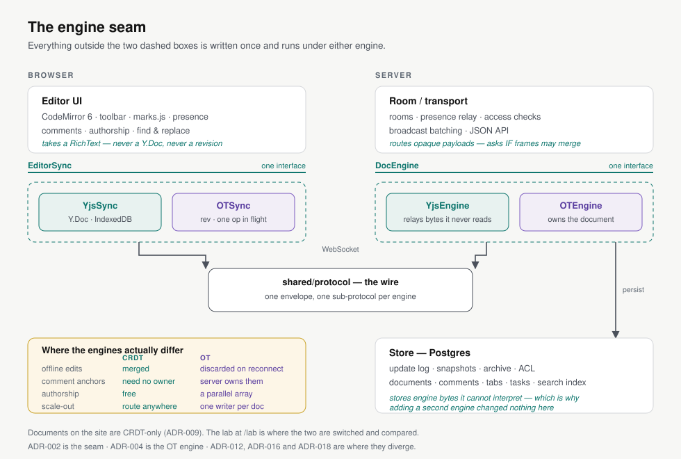
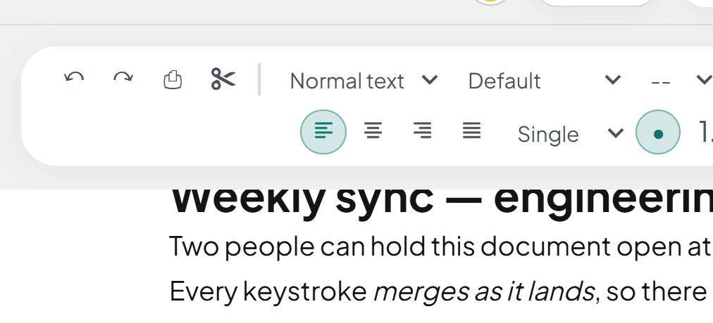
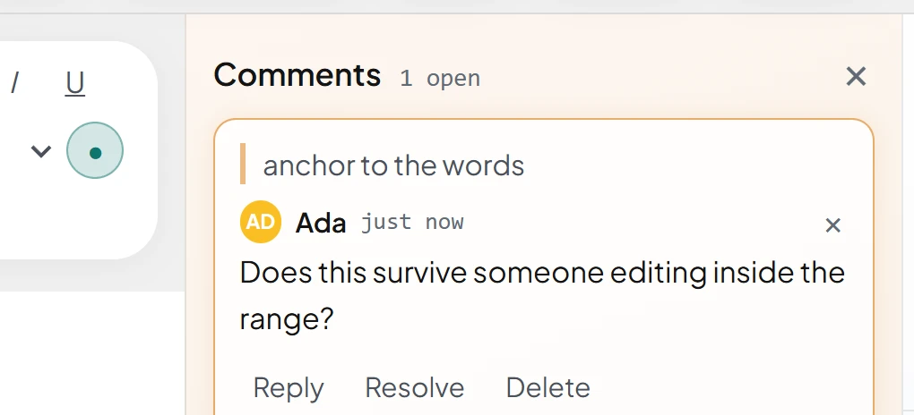
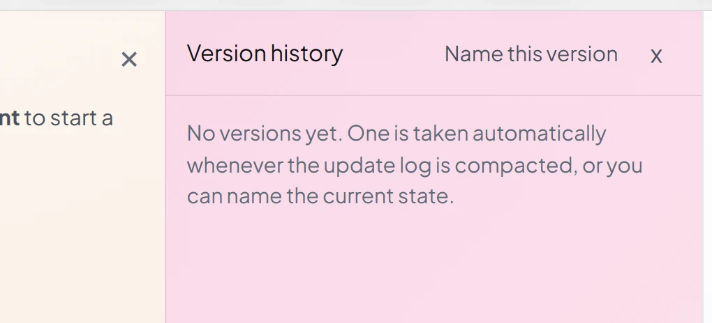
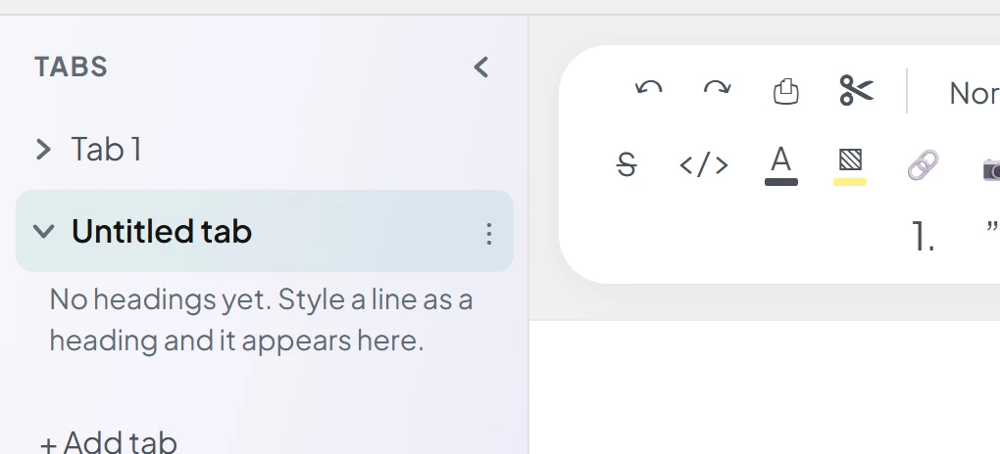
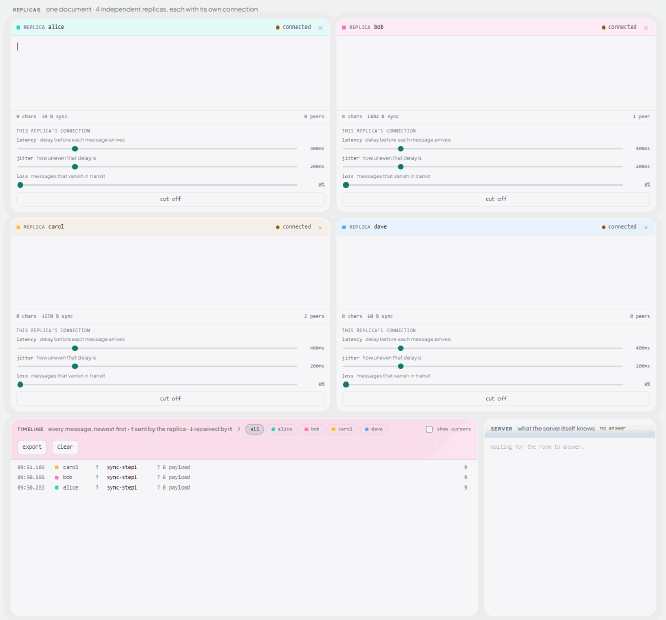
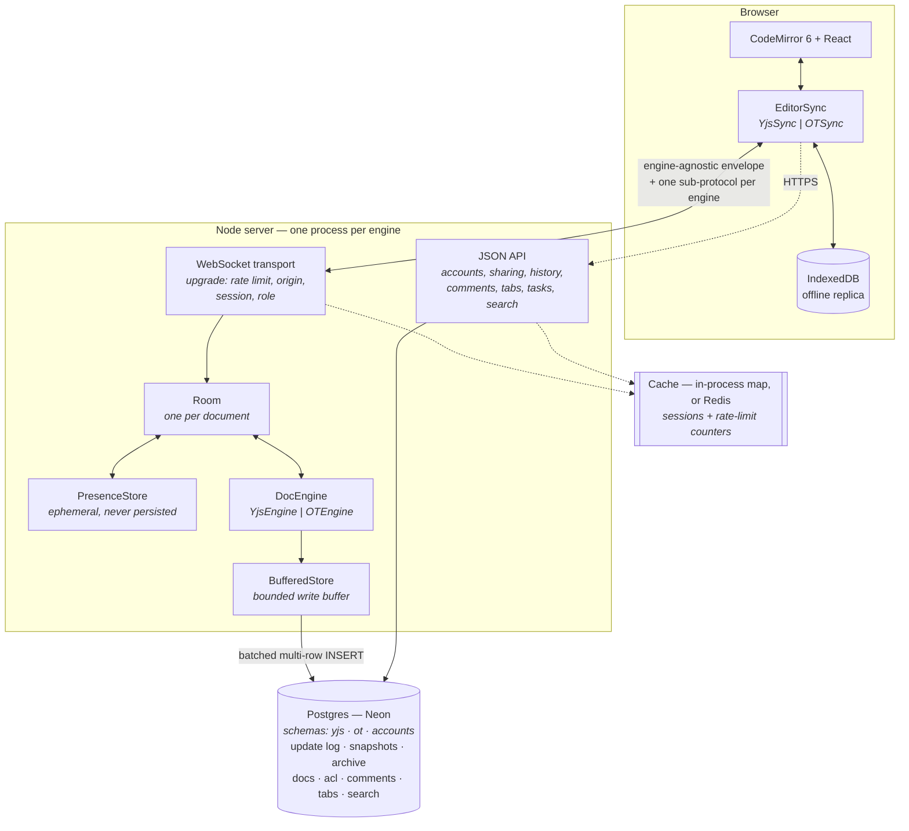

<div align="center">

# Collab Docs

## Real-time collaboration, built twice.

A collaborative rich-text editor with **one editor, one transport, one storage layer — and two
interchangeable concurrency engines**: a Yjs CRDT, and a hand-written, server-authoritative OT.

Because everything except the concurrency layer is shared, a difference between the two is the
*algorithm* — not two different applications.

[](https://github.com/poojanegi17/collab-docs/actions/workflows/ci.yml)

### **[▶ Live app](https://collab-client-kvn5.onrender.com)** · **[The lab](https://collab-client-kvn5.onrender.com/lab)** · **[23 ADRs](docs/decisions/)**

**[Core idea](#the-core-idea-one-application-two-engines)** · **[CRDT vs OT](#crdt-vs-ot)** · **[What I measured](#what-i-actually-measured)** · **[Architecture](#architecture)** · **[Under the hood](#under-the-hood)** · **[Scale boundary](#deployment-and-the-scale-boundary)**

</div>



<div align="center">

**Same document, same application. Cut the network, keep typing on both sides, then heal.**

**CRDT above** merges both sides of the partition.
**OT below** discards the disconnected work — the reconnecting client is handed the server's
document, because that is what server authority means ([ADR-004](docs/decisions/004-ot-engine.md)).

<sub>Not an animation. <code>npm run record</code> drives two real labs through the same script in
lockstep and encodes what actually happened.</sub>

</div>

---

## By the numbers

<div align="center">

| **2** | **23** | **46** | **8,000** |
|:---:|:---:|:---:|:---:|
| concurrency engines,<br>one interface | architecture<br>decision records | test harnesses,<br>all in CI | OT property assertions<br>per run, replayable |

| **0** | **~24×** | **3** | **1** |
|:---:|:---:|:---:|:---:|
| characters lost across a<br>measured `SIGKILL` | fewer broadcast messages<br>in a busy room | Render services,<br>live | Postgres,<br>the source of truth |

</div>

Each figure is produced by a script in `tools/` that CI re-runs — several of which refuse to report
success if the underlying property broke. Method for each: **[What I actually
measured](#what-i-actually-measured)**.

---

## The core idea: one application, two engines

Most collaborative editors hide concurrency control behind an SDK. You call `connect(docId)`, edits
appear in other people's browsers, and the questions that make the problem interesting never
surface.

**The project was built twice at the concurrency layer and once everywhere else.**

```
                        SHARED APPLICATION
       CodeMirror · formatting · presence · comments · history
              tabs · tasks · search · authorship · auth
                                 │
                                 ▼
                           ENGINE SEAM
              EditorSync (client) · DocEngine (server)
                    ┌────────────┴────────────┐
                    ▼                         ▼
                Yjs CRDT              Hand-written OT
        convergence by construction   server-authoritative
                    └────────────┬────────────┘
                                 ▼
                    SHARED INFRASTRUCTURE
        WebSocket transport · update log · Postgres · cache
```

Two interfaces are the entire engine-aware surface, and **nothing above them imports Yjs**. The
seam is the load-bearing decision ([ADR-002](docs/decisions/002-engine-seam.md)), and it pays twice
over: the comparison stays honest, and every place the abstraction *fails* becomes a documented
finding rather than a quiet special case. That has happened three times — comment anchors,
authorship, and the product's engine choice — each with its own ADR.



<sub>The two dashed boxes are the only engine-aware code. The panel at the lower left lists every
place that stops being true.</sub>

---

## CRDT vs OT

Both engines are complete and both are exercised by the same harnesses — the end-to-end suites run
twice, once per engine.

| | **CRDT (Yjs)** | **OT (hand-written)** |
|---|---|---|
| **Authority** | In the data structure; no server needs to agree | On the server, which orders operations and assigns revisions |
| **Conflict model** | Commutative merge — any order, any number of times | Transform — rebased against everything accepted since its base revision |
| **Concurrent ops** | Unbounded; a client sends whatever it has | Exactly one in flight, with a single composed buffer behind it |
| **Offline editing** | Merges back on reconnect | **Discarded** on reconnect |
| **Reconnect cost** | Delta sync from a state vector — proportional to what changed | Replay from the client's last revision, bounded by server history |
| **Document growth** | Never shrinks back to just its text; tombstones accumulate | Text stays text; only the server's history needs a bound |
| **Comment anchors** | Relative positions carried by the character | Transformed indices, server-owned — **diverge under deletion** |
| **Authorship** | Free; the structure knows who inserted each character | Built by hand in a parallel array; names do not survive a restart |
| **Broadcast batching** | Permitted — merging is legal because updates are idempotent | Refused — the sender awaits an ack that is specifically theirs |
| **Role here** | **The default.** Every real document on the site | The lab, `/engines`, and both test suites |

**Neither is universally better.** The CRDT is the product's default because offline work vanishing
is not something you can disclose in a tooltip, and because the choice does not belong to the person
writing a document — so it moved to the lab, where the difference is demonstrated rather than
offered ([ADR-009](docs/decisions/009-crdt-only-product.md)). OT keeps text as text with no metadata
growth, and a server that orders every operation can enforce invariants a commutative merge cannot.

---

## See it in action

<table>
<tr>
<td width="50%"></td>
<td width="50%"></td>
</tr>
<tr>
<td valign="top"><b>Formatting is part of the shared document model</b> — attributes on ordinary operations, not a second model (<a href="docs/decisions/006-rich-text.md">ADR-006</a>).</td>
<td valign="top"><b>Comments expose the seam</b> — a relative position under the CRDT, transformed indices under OT (<a href="docs/decisions/012-comment-anchors.md">ADR-012</a>).</td>
</tr>
<tr>
<td width="50%"></td>
<td width="50%"></td>
</tr>
<tr>
<td valign="top"><b>Restore is an ordinary collaborative edit</b> — so collaborators see it live, and it can be undone (<a href="docs/decisions/008-version-history.md">ADR-008</a>).</td>
<td valign="top"><b>Tabs stay engine-agnostic</b> — a tab is a document with its own room and log; storage never learned what one is (<a href="docs/decisions/014-document-tabs.md">ADR-014</a>).</td>
</tr>
</table>

**[The lab](https://collab-client-kvn5.onrender.com/lab)**: one document, up to eight replicas, each
with its own socket and its own network conditions.



> Four replicas at 400ms latency and 200ms jitter. `carol` is cut off — the socket stays open, the
> frames go nowhere — and keeps typing. On reconnect all four land on the same 74 characters and
> read **synced**. The **timeline** is every frame in both directions, decoded and sized; the
> **server panel** is what the room itself knows. In this run the CRDT's state vector was **25 B**
> against a **339 B** snapshot — the delta-sync argument, in one document's numbers.
>
> Recorded by `npm run record:lab` against the deployed site.

---

## What I actually measured

**A number you cannot reproduce is a claim, not a measurement.** Each result below comes from a
harness that CI re-runs. *How* the system implements these is in [Under the
hood](#under-the-hood).

### Partition and heal

**Tested** — `tools/lab-test.mjs` drives the real lab in Chrome: partition both replicas, edit on
both sides, heal. Run again with `--engine=ot` and the assertion **flips**.

**Result** — under the CRDT it asserts *both sides of the partition survive the heal*; under OT it
asserts they *do not*, because the reconnecting client is resynced to the server's document.

**Why it matters** — the divergence is encoded as a passing assertion in each direction rather than
described in prose. It is not a bug in OT but the visible consequence of where authority lives, and
the clearest argument for the CRDT being the product's default.
→ [ADR-004](docs/decisions/004-ot-engine.md)

### Crash durability

**Tested** — `tools/measure-durability.mjs` boots a server, `SIGKILL`s it mid-burst, restarts it and
counts characters. Counted, not asserted.

**Result** — `frontend/src/ui/landing/durability.json`, Node v24.16.0:

| Written | Typed while the process was dead | Recovered | Lost |
|---:|---:|---:|---:|
| 1,170 | 330 | 1,170 | **0** |

**Why it matters** — the run uses strict write-through (`PERSIST_WINDOW_MS=0`), so it measures the
storage layer rather than the [default buffering trade-off](#update-buffering--one-guarantee-traded-for-latency).
The harness refuses to write a record if anything *was* lost, and a cold client that never saw the
original session must agree with the result.

### Broadcast batching

**Tested** — relaying every keystroke to everyone makes traffic grow with the square of the room.
Outbound frames are held 50ms and merged into one.

**Result** — with everyone typing, messages collapse by **about 25× at a hundred editors**, while
the **bytes fall by only about a third**.

**Why it matters** — it fixes message *count*, not bandwidth. Every client genuinely needs every
edit and no window makes an edit smaller, so the quadratic cost is now paid in bytes rather than
messages — and a message is the expensive unit. Below five clients the merged frame costs more than
it saves, a threshold read off the measurement rather than picked.
→ [ADR-016](docs/decisions/016-broadcast-batching.md)

### OT property testing

**Tested** — hand-written transforms fail on cases nobody thinks to write: a delete spanning an
insert, an insert at the exact end of a document, two deletes overlapping by one character. So the
*laws* are tested instead of examples.

**Result** — 2,000 random documents × 4 laws = **8,000 assertions** per run: TP1 convergence, the
same law over composition, composition itself, and JSON round-tripping.
`tools/rich-ot-properties.mjs` repeats it for attributed operations.

**Why it matters** — a law holds for all inputs or it does not hold. Every run is seeded, so a
counterexample found in CI replays verbatim with `--seed=N`.

### Comment anchors

**Tested** — `tools/anchor-properties.mjs` fuzzes anchor behaviour under concurrent edits on both
engines.

**Result** — OT anchors **converge under insertion and diverge under deletion**, with the
counterexample pinned as a regression test.

**Why it matters** — **the best abstractions are the ones that eventually break.** Rather than
forcing one anchor representation onto both engines, the limitation is recorded as a *passing test*.
→ [ADR-012](docs/decisions/012-comment-anchors.md)

### CRDT vs OT under latency

**Tested** — a burst of typing across a simulated two-second link.

**Result** — about **2.3s under the CRDT**, about **6.1s under OT**.

**Why it matters** — structural, not an implementation detail to optimise away. OT keeps one edit in
flight, so each costs two round trips. → [ADR-005](docs/decisions/005-network-simulation.md)

---

## Architecture



The envelope crossing the socket is engine-agnostic; the transport never decodes a payload. Only
that engine's sub-protocol can ([`shared/protocol/`](shared/protocol/src)).

**One keystroke, end to end:**

`editor transaction` → `EditorSync` produces an engine update → **engine-agnostic envelope** over the
socket → **authorization** (role resolved at upgrade; a viewer's edit is dropped at the socket, not
hidden in the UI) → **engine applies** (Yjs merges; OT transforms against everything since its base
revision and assigns a revision) → **broadcast** (merged in a 50ms window under the CRDT, individually
under OT) → **write buffer** → **Postgres, and only now is it durable** → **compaction** into a
snapshot every `COMPACT_AFTER` updates, superseded rows moved to an archive.

Presence never enters that path: relayed by the transport, never touching the engine, never reaching
Postgres.

---

## Under the hood

### Transport and room lifecycle

A raw `ws` server, no framework. On upgrade the connection is rate-limited, its origin checked, its
session resolved to a user and its role resolved against the document's ACL — all *before* the
handshake completes. Clients are grouped into a `Room` keyed by document id; the room owns one
engine instance and its sockets, and dies when the last one leaves. Rooms are in-process, which sets
the [scale boundary](#deployment-and-the-scale-boundary).

### CRDT synchronization — the product

Yjs, chosen first because convergence is a property of the data structure rather than of a server's
ordering: replicas apply updates in any order, any number of times, and land in the same state. That
makes offline editing nearly free and makes the client authoritative over its own work.

Reconnecting is a **delta sync** — the client sends a state vector, the server replies with only the
difference. The accepted cost: a CRDT document never shrinks back to just its text.
→ [ADR-001](docs/decisions/001-crdt-over-ot.md)

### OT implementation — the lab

A complete operational-transform engine in [`shared/ot/`](shared/ot/src): pure, no network,
property-tested, with plain-text `TextOperation` and attributed `RichTextOperation` side by side.

The client is the **three-state Jupiter machine** — `SYNCHRONIZED`, `AWAITING_CONFIRM`,
`AWAITING_WITH_BUFFER`. One operation in flight, and anything typed behind it is *composed* into a
single buffered operation, so the buffer never grows past one: type 50 characters while an ack is
outstanding and you send one op, not 50. → [ADR-004](docs/decisions/004-ot-engine.md)

### Presence

Ephemeral by design, and one of the clearest boundaries in the system:

- **Not persisted.** A cursor position is meaningless the moment you disconnect; writing it would put
  keystroke-rate load on the database for data with a lifetime of milliseconds.
- **Not engine-owned.** Cursors behave identically under both engines, so presence lives in
  transport, *above* the seam.
- **Last-write-wins per client, no merging.** A lost update is corrected by the next one ~50ms later.
  Deliberately the weakest correct thing.

### The update log and snapshots

A document is not a blob that gets rewritten; it is an **append-only sequence of updates**, and
reading it is snapshot + tail. Past `COMPACT_AFTER` (default 200) loose updates, the tail is folded
into a new snapshot and superseded rows move to an archive that version history reads — so
compaction reclaims read cost without destroying the past.
→ [ADR-003](docs/decisions/003-storage-log-and-snapshots.md)

### Update buffering — one guarantee traded for latency

Once storage moved to a managed Postgres, appending once per keystroke put a network round trip
directly on the acknowledgement path. So appends accumulate per document in a bounded buffer and are
written as one multi-row `INSERT` (`PERSIST_WINDOW_MS`, default 25ms).

**This is a real, deliberate reduction in server-side durability** — and the only place in the
codebase where a guarantee is traded for latency. Precisely:

| | |
|---|---|
| **Default runtime** | Up to one window of accepted updates may be in memory and not yet in Postgres. A crash loses them |
| **Strict mode** | `PERSIST_WINDOW_MS=0` restores exact write-through. Every durability harness sets it |
| **Not user-visible loss** | Connected replicas still hold the state and heal the log on reconnect — the window is server-side unless every client vanishes in the same instant |
| **Flush-before-read** | `BufferedStore` flushes before every read path that could observe the log, so no caller can forget |
| **The alternative** | Without it, five people typing into one document generates five round trips per keystroke |

The [durability measurement](#crash-durability) runs in strict mode, so it characterises the storage
layer rather than this window.

### Postgres as the source of truth

The host discards its filesystem on every deploy, and a document's history *is* the document. One
Postgres database therefore holds everything durable, with each engine's documents in its own schema
and accounts shared.

There is **no local-file fallback**, deliberately: a server that quietly degraded to disk when it
could not reach the database would look healthy and lose every document at the next restart. It
refuses to start instead. The rule the rest of the design obeys — *a change is durable when Postgres
has it, and nothing else may claim otherwise* — is why cursors, fan-out, the room registry, the write
buffer and the session cache are all explicitly allowed to be lost.
→ [ADR-019](docs/decisions/019-postgres-source-of-truth.md)

---

## Engineering challenges

Four problems whose interest is in the design rather than a number.

### 01 — Offline editing that survives the tab closing

**Problem.** Typing through a dropped socket is the easy half. The hard half is the tab closing
*during* the outage: an in-memory replica takes the unsent edits with it, and for a guest document —
which the server files under nobody — that is the whole document.

**Approach.** The replica is mirrored to IndexedDB as it changes, so a reload with the server
unreachable returns with the work intact and syncs when the network does.
`tools/offline-persistence-test.mjs` drives that in real Chrome, reload included.

**Trade-off.** Disabled in the lab, where every replica shares one browser — a shared local store
would let a partitioned pair converge through the disk, making the demonstration a lie.

### 02 — Authorization at the socket boundary

**Problem.** The obvious IDOR: a document id in a URL, a client that renders a read-only editor, and
nothing stopping a modified client from sending an edit anyway.

**Approach.** Roles are resolved at socket upgrade from the ACL and carried on the connection; an
edit from a connection that cannot write is dropped in the room. When sharing changes,
`recheckAccess` re-reads every connected client's role and re-issues its hello or disconnects it, so
revocation takes effect mid-session. The read-only editor is a courtesy; the socket is the boundary.

**Trade-off.** Two places know about roles — the room and the hello payload — and they drifted apart
once, which is why both are built from one function today.
→ [ADR-007](docs/decisions/007-accounts-and-sharing.md)

### 03 — Rate limiting an expensive unauthenticated operation

**Problem.** Sign-in hashes a password with scrypt at `N = 32768` — roughly 100ms of *blocked event
loop*. On a single-threaded server that is a denial-of-service vector before it is a
credential-stuffing one. Separately, opening an unknown document id *creates* it, so unmetered
upgrades are unbounded document creation.

**Approach.** Four tiers with independent windows: `auth` (10 / 15 min), `write` (120 / min), `read`
(600 / min), `socket` (120 / min, refused *before* the handshake). Counters use Redis when
`REDIS_URL` is set and an in-process map when it is not — the fallback has no network hop and is
faster on one instance; what Redis buys is surviving a restart, routine on a host that sleeps.

**Trade-off.** `/api/health` is exempt, being both health check and keep-alive target — so it answers
in aggregates only, never naming a document.
→ [ADR-023](docs/decisions/023-redis-as-a-cache-and-rate-limiting.md)

### 04 — What the engine abstraction costs

**Problem.** An interface over two algorithms is roughly the *intersection* of what they can do. A
feature only one supports has nowhere obvious to live.

**Approach.** Make each leak an explicit decision rather than a quiet special case — comment anchors,
authorship, and the product's engine choice.

**Trade-off.** Three features cost more than they would in a single-engine codebase. In exchange,
images and tables were added without either engine changing at all
([ADR-013](docs/decisions/013-blocks-without-a-tree.md)), and tabs, tasks and search never learned
which algorithm was underneath.
→ [ADR-018](docs/decisions/018-authorship.md)

---

## Persistence

What survives a restart, and why. Three schemas: `yjs` and `ot` for each engine's documents,
`accounts` shared — a document's log is bytes only its own engine can read, but a user is not
engine-specific.

| Table | Holds |
|---|---|
| `updates` | The append-only log — one row per accepted update, ordered by `seq` |
| `snapshots` | Periodic compaction, so a read is snapshot + tail |
| `archive` | Updates superseded by compaction, which version history reads |
| `checkpoints` | Named versions |
| `docs`, `acl` | Titles, owners, per-user roles |
| `comment_threads`, `comments` | Threads with engine-opaque anchors, and their bodies |
| `tabs`, `tasks` | Document structure and the shared checklist |
| `doc_search` | A GIN-indexed `tsvector` projection — one index serving both engines ([ADR-017](docs/decisions/017-search-projection.md)) |
| `users`, `sessions`, `identities` | Accounts, hashed session tokens, federated credentials |

**Operational details that earned their place**

- **DDL runs on every boot, idempotently, under a Postgres advisory lock** — `CREATE TABLE IF NOT
  EXISTS` is not concurrency-safe, and without the lock the two engine servers race on a cold boot.
- **Every statement is schema-qualified**, rather than trusting `search_path` through a pooler.
- **Two roles.** The server authenticates as a least-privilege role — DML in the three schemas, no
  `CREATE` anywhere, no `CREATEROLE`, no `BYPASSRLS`. DDL runs separately as the owner over the
  direct endpoint via `npm run migrate`; the owner credential is never in the running service's
  environment.

---

## Production hardening

Production-minded engineering under explicit constraints. This describes the current design; it is
not a claim that the application is secure.

| Area | What was done |
|---|---|
| **Passwords** | scrypt, per-user salt, `N = 32768` (~100ms), constant-time comparison |
| **Sessions** | 32 random bytes, stored only as a SHA-256 hash; cached for `SESSION_CACHE_MS`, revocable — harnesses set `0` to assert revocation against the strict path |
| **Federated identity** | Google ID tokens verified against Google's published keys with the **algorithm pinned** rather than read from the token, audience matched against `GOOGLE_CLIENT_ID`. *Identity is federated; authority is not* — Drive access is a separate consent ([ADR-020](docs/decisions/020-federated-identity.md)) |
| **Authorization** | Enforced at the socket, with mid-session revocation ([challenge 02](#02--authorization-at-the-socket-boundary)) |
| **Rate limiting** | Four tiers, socket tier refused pre-handshake ([challenge 03](#03--rate-limiting-an-expensive-unauthenticated-operation)) |
| **Input validation** | Collaborators' formatting values are untrusted input and meet an allowlist before reaching the DOM — no `javascript:` links, no CSS escaping its property (`tools/attribute-safety-test.mjs`) |
| **XSS surface** | `/decisions` renders Markdown tokenized **at build time**: no parser in the bundle, no HTML in the pipeline to inject into |
| **Database privilege** | `tools/security-check.mjs` asserts the runtime role holds DML only, against whatever `DATABASE_URL` it is given — including in CI |
| **Secrets** | Every credential is an unsynced environment variable; the static bundle carries only values public by nature |
| **CORS** | `ALLOWED_ORIGINS` allowlist; credentials ride in the `Authorization` header, never a cookie |
| **Health endpoint** | The one unauthenticated route, reporting aggregates only, so it cannot enumerate documents |
| **Shutdown** | Buffers flush and rooms close on signal (`tools/shutdown-test.mjs`) |

---

## Testing

**46 harnesses** in two suites, all in CI on every push. These are not unit tests around isolated
helpers: every harness drives the **real** client sync class over the **real** wire protocol, and the
browser suite drives real Chrome.

| Kind | What it protects | Examples |
|---|---|---|
| **Property** | Transform laws for all inputs, seeded so failures replay | `ot-properties`, `rich-ot-properties`, `anchor-properties` |
| **Durability** | That a `SIGKILL` mid-sentence loses nothing, and the published number stays true | `restart-test`, `measure-durability`, `persistence-race-test`, `db-contention-test` |
| **Both-engine E2E** | Features above the seam under *either* engine — comments, blocks, tabs, tasks, search, authorship each run twice | `checklist`, `ot-checklist`, `comments-test`, `blocks-test`, `tabs-tasks-test`, `search-test`, `authorship-test` |
| **Security** | Refusals rather than successes: rejected ID tokens, each rate-limit tier, sanitiser bypasses, database privilege | `google-auth-test`, `auth-security-test`, `rate-limit-test`, `attribute-safety-test`, `security-check` |
| **API / lifecycle** | Accounts, sharing, history, guest claim-and-share, room teardown, clean shutdown | `api-test`, `guest-flow-test`, `room-lifecycle-test`, `shutdown-test`, `no-local-state-test` |
| **Real Chrome** | The journeys under both engines — partition and heal, offline typing then a **reload**, deleting a tab someone else is reading | `browser-test`, `lab-test`, `offline-persistence-test`, `comments-ui-test`, `docs-page-test` |
| **Non-functional** | Accessibility on every route — accessible names, Tab reachability, focus visibility, heading structure, WCAG AA contrast, computed from live DOM and CSSOM rather than a rule library — plus a gzipped bundle ceiling and eight viewports | `a11y-test`, `bundle-budget`, `responsive-test`, `app-responsive-test` |
| **Configuration** | That the workflows and `render.yaml` parse and say what they should — run *first*, since a workflow that does not parse never reaches a runner | `config-check`, `generate-adr-index --check` |

```bash
npm test               # 31 headless harnesses, in order
npm run test:browser   # 15 real-Chrome harnesses, both engines
```

**CI** ([`ci.yml`](.github/workflows/ci.yml)) is three jobs split by what they *need*: `pure` (Node
only), `e2e` (both servers and a database), `browser` (plus Vite and real Chrome). Each
database-using job creates its **own ephemeral Neon branch**, runs against it and deletes it — so CI
never touches production data and concurrent runs cannot drop each other's scratch schemas. It
connects as the [restricted role](#persistence), not the owner: handing it the owner made every
least-privilege assertion pass vacuously.

---

## Deployment and the scale boundary

> **Rooms, presence and pub/sub are in-process, so each engine is deployed as a single instance and
> autoscaling is off.**
>
> This is the most important operational fact about the system. Two instances of the same engine
> would each hold half the people in a document and neither would know about the other. The
> append-only log in Postgres would stay correct, so it would not crash or error — it would present
> as *"collaboration is broken"*, silently. Raising the instance count is therefore not a
> configuration change but an architectural one.
>
> `RoomRegistry`, `PubSub` and `PresenceStore` are already interfaces with in-process
> implementations; Redis-backed coordination is the next boundary, and `render.yaml` carries the
> reasoning at the top of the file.

Three Render services and a Neon database, declared in [`render.yaml`](render.yaml):

| Service | Runtime | Responsibility | Live |
|---|---|---|---|
| `collab-client` | static | The Vite build; no secrets, only public values compiled in | **[collab-client-kvn5.onrender.com](https://collab-client-kvn5.onrender.com)** |
| `collab-yjs` | node | The CRDT server: every real document, plus the JSON API | [`/api/health`](https://collab-yjs-1f8k.onrender.com/api/health) |
| `collab-ot` | node | The OT server: the lab's second engine | [`/api/health`](https://collab-ot.onrender.com/api/health) |
| Neon Postgres | — | The source of truth; not declared in the blueprint | — |

- **Migrations run as the owner, from outside the service.** `preDeployCommand` is a paid feature
  *ignored* rather than rejected on the free plan, so the schema would silently never be created; the
  blueprint documents the manual command instead.
- **Both engine servers share one Redis instance and key prefix**, because a session is valid on
  both. Postgres gets that isolation from schemas; Redis has none, hence `REDIS_PREFIX`.
- **A keep-alive cron pings `/api/health` every 10 minutes**, which calls `store.listDocs` and so
  keeps both the container and the Neon compute warm. Only the CRDT service is pinged, to stay inside
  the free tier's instance hours — so a first visit to the OT lab waits for a container to start
  ([ADR-022](docs/decisions/022-cold-start-not-caching.md)).

---

## Tech stack

| Layer | Technology | Why it is there |
|---|---|---|
| Editor | CodeMirror 6 | Decorations carry formatting, comments and authorship |
| UI | React 19 + Vite 8 | Shell, panes, lab, landing, `/decisions` |
| CRDT | Yjs | Convergence as a property of the data structure |
| CRDT ↔ editor | `y-codemirror.next` | Binds the shared type to the editor, including remote cursors |
| Offline | `y-indexeddb` | Mirrors the replica to disk so a reload during an outage keeps the work |
| OT | Hand-written (`shared/ot/`) | `TextOperation`, `RichTextOperation`, transform and compose |
| Wire protocol | Hand-written (`shared/protocol/`) | Engine-agnostic envelope + one sub-protocol per engine |
| Transport | `ws` (raw WebSockets) | Rooms, presence relay, upgrade-time auth and rate limiting. No framework |
| Server | Node.js (`>=22`; CI and production run 24) | One process per engine; the JSON API shares the port |
| Database | Postgres (Neon) | The source of truth |
| Driver | `pg` | Pooled, schema-qualified, parameterised |
| Cache | Redis via `ioredis`, **optional** | Session cache and rate-limit counters that survive a restart |
| Tests | `puppeteer-core` + plain Node | Drives the installed Chrome; everything else drives the sync classes directly, so a UI bug cannot be mistaken for a protocol one |
| CI/CD | GitHub Actions + Render | Three jobs on ephemeral Neon branches; three services |

---

## Repository structure

```
frontend/
  src/sync/          EditorSync interface + YjsSync + OTSync. Runs in Node too,
                     which lets harnesses test the protocol without a browser.
  src/net/           SimulatedSocket: latency, jitter, drop, partition (ADR-005).
  src/presence/      Remote cursor rendering. Engine-agnostic.
  src/ui/lab/        Multi-replica view, per-replica network controls, decoded
                     frame timeline, the server's own view, guided runs, glossary.
  src/ui/            React + CodeMirror: editor, toolbar, comments, history, tabs,
                     tasks, sharing, accounts, import, landing, /decisions.

backend/
  src/engines/       DocEngine interface + YjsEngine + OTEngine, including whether
                     an engine's frames may be merged (ADR-016).
  src/transport/     WebSocket rooms, presence relay, routing, JSON API, rate limiting.
  src/realtime/      The seams distributed coordination will use: pub/sub, presence
                     store, room registry — and the bounded write buffer.
  src/storage/       Update log, snapshots, archive, docs, ACL, comments, accounts.
                     db.js is the only file that knows we are on Postgres.
  src/auth/          Provider ID-token verification, algorithm pinned (ADR-020).
  src/cache/         Keyed cache with expiry: in-process map, or Redis when configured.

shared/
  protocol/          Engine-agnostic envelope + one sub-protocol per engine.
  ot/                The OT algorithm. Pure, no network, property-tested.

tools/               55 scripts: harnesses, property runners, the durability
                     measurement, the ADR index generator, the demo recorders.
docs/decisions/      23 ADRs — the architectural history of the project.
```

`frontend`, `backend` and `shared/*` are npm workspaces. Three files worth opening first:

| | |
|---|---|
| [`shared/ot/src/text-operation.js`](shared/ot/src/text-operation.js) | The transform, with no network in the way |
| [`backend/src/realtime/update-buffer.js`](backend/src/realtime/update-buffer.js) | The one guarantee traded for latency, with the trade written out |
| [`docs/decisions/`](docs/decisions/) | Why any of it is shaped this way |

---

## Running locally

Requires **Node 22+** and a Postgres database — there is no local-file fallback, [by
design](#postgres-as-the-source-of-truth). A free [Neon](https://neon.tech) project works.

```bash
git clone https://github.com/poojanegi17/collab-docs.git
cd collab-docs
npm install

# Create the schema once, as the database OWNER (direct, non-pooler endpoint).
DATABASE_URL_ADMIN='postgres://...' npm run migrate

DATABASE_URL='postgres://...' npm run dev
```

`npm run dev` starts three processes: the **CRDT server** on `8080`, the **OT server** on `8081`, and
the **Vite client** on `5173`.

Open **http://localhost:5173/** and press **+ New document** — no account needed; the document is
*unowned*, and anyone with the link can edit it. Sign up only to **share** one
([ADR-010](docs/decisions/010-guest-documents.md)). A second tab shows convergence; watching
*sharing* needs two **people**, so use a second browser profile — the session token lives in
`localStorage`, which tabs share.

| Route | What | Live |
|---|---|---|
| `/lab` | One document, up to eight replicas, real network controls | [try it](https://collab-client-kvn5.onrender.com/lab) |
| `/lab?engine=ot` | The same run under OT — the reconnecting replica's offline work is discarded | [try it](https://collab-client-kvn5.onrender.com/lab?engine=ot) |
| `/engines` | How each engine reconciles concurrent edits, worked through | [try it](https://collab-client-kvn5.onrender.com/engines) |
| `/decisions` | All 23 ADRs, generated from `docs/decisions/` at build time | [try it](https://collab-client-kvn5.onrender.com/decisions) |

`DATABASE_URL` is the only required variable. `REDIS_URL`, `GOOGLE_CLIENT_ID`, `ALLOWED_ORIGINS` and
the tuning knobs (`PERSIST_WINDOW_MS`, `BROADCAST_WINDOW_MS`, `COMPACT_AFTER`, `BATCH_MIN_CLIENTS`,
the four `RATE_LIMIT_*` tiers) are optional and documented with defaults in
**[docs/deploy.md](docs/deploy.md)**. Flags beat environment variables, which beat defaults.

---

## The decision record

Twenty-three ADRs in [`docs/decisions/`](docs/decisions/), also rendered at
[`/decisions`](https://collab-client-kvn5.onrender.com/decisions). They are the project's
architectural history, not a changelog — each states the decision, the reasoning, and, on the fifth
line before any prose, **the consequence it accepted**:

> **ADR-001** · *Offline editing is nearly free, but a document never shrinks back to just its text.*
>
> **ADR-004** · *Server authority is real: work done while offline is discarded on reconnect.*
>
> **ADR-012** · *Measured: anchors converge under insertion and diverge under deletion.*
>
> **ADR-019** · *Nothing durable lives on the local disk, so a deploy that wipes it loses nothing.*
>
> **ADR-020** · *Identity is federated; authority is not.*

`tools/generate-adr-index.mjs` builds the page from the source files, and `--check` fails a stale one
in CI — so the record and the site cannot drift apart.

---

## What this project taught me

**The editor was never the hard part.** CodeMirror is excellent and a toolbar is an afternoon.
Everything genuinely difficult here is about shared state that more than one process believes it
owns.

- **Convergence is a design property, not a bug class.** You do not debug your way to two replicas
  agreeing — you choose a structure that makes disagreement impossible, or an authority that resolves
  it, then live with that choice in public.
- **Reproducible measurements beat impressive ones.** The durability harness refuses to record a
  success if anything was lost, specifically so a future me cannot quietly break it.
- **Good abstractions expose their limits.** The seam held for rich text, presence, tabs, tasks and
  search, then broke for comment anchors and authorship — and those breaks taught me more than the
  features that fit.
- **Durability is a spectrum.** Bounding the write window, making it configurable, and keeping a
  harness that turns it off is what separates a stated trade-off from a bug you have not found yet.
- **Single-instance correctness is not distributed correctness.** Rooms in a `Map` are correct until
  they are not, and the failure is silent — which is why it is written at the top of `render.yaml`
  rather than left to be discovered.
- **Security boundaries belong at enforcement points.** A read-only editor is a courtesy; the socket
  is the boundary.

---

## Roadmap

- [x] CRDT synchronization with delta sync on reconnect
- [x] A second, complete engine — hand-written OT with server authority
- [x] Rich text, comments, tabs, tasks, search, authorship and version history above the seam
- [x] Append-only log with snapshots, compaction and an archive
- [x] Postgres as the source of truth, with no local-disk fallback
- [x] Accounts, per-document roles, guest documents and federated identity
- [x] Rate limiting, optional Redis cache, least-privilege database role
- [x] 46 harnesses in CI on ephemeral Neon branches, including real Chrome and accessibility

**The next architectural boundary** is distributed coordination — lifting the
[single-instance limit](#deployment-and-the-scale-boundary) rather than fixing a defect:

- [ ] Redis-backed `RoomRegistry`, `PubSub` and `PresenceStore`
- [ ] A distributed write buffer, so it survives the process and a document's writes drain from
      whichever instance is up
- [ ] Richer causal visualisation in the lab — the operation graph, not just the frame list
- [ ] Observability beyond `/api/health`: per-room latency histograms exported rather than polled

---

## Engineering questions this project explores

| Question | Where it is answered |
|---|---|
| What guarantees two replicas converge — and how do you *test* that rather than demonstrate it? | [`properties.js`](shared/ot/src/properties.js) · [ADR-001](docs/decisions/001-crdt-over-ot.md) |
| Who decides the order when two people type into the same offset, and what does having an answer cost? | [CRDT vs OT](#crdt-vs-ot) · [ADR-004](docs/decisions/004-ot-engine.md) |
| How do you keep database latency off the realtime path without silently weakening durability? | [`update-buffer.js`](backend/src/realtime/update-buffer.js) · [ADR-019](docs/decisions/019-postgres-source-of-truth.md) |
| What is lost when a collaboration server is `SIGKILL`ed mid-sentence? | [Crash durability](#crash-durability) |
| Which parts of a realtime system must *never* be persisted? | [`presence-store.js`](backend/src/realtime/presence-store.js) |
| What breaks — silently — when you run two instances of a server holding rooms in memory? | [Scale boundary](#deployment-and-the-scale-boundary) |
| When is OT the better choice, and what does server authority buy? | [ADR-009](docs/decisions/009-crdt-only-product.md) |
| Where does an abstraction over two concurrency algorithms *have* to leak? | [ADR-012](docs/decisions/012-comment-anchors.md) · [ADR-018](docs/decisions/018-authorship.md) |
| Why is rate limiting a correctness concern before it is a security one? | [ADR-023](docs/decisions/023-redis-as-a-cache-and-rate-limiting.md) |

<div align="center">

---

**[Read the decision record →](docs/decisions/)**

Every architectural choice, with the consequence it accepted, stated in one line.

</div>
